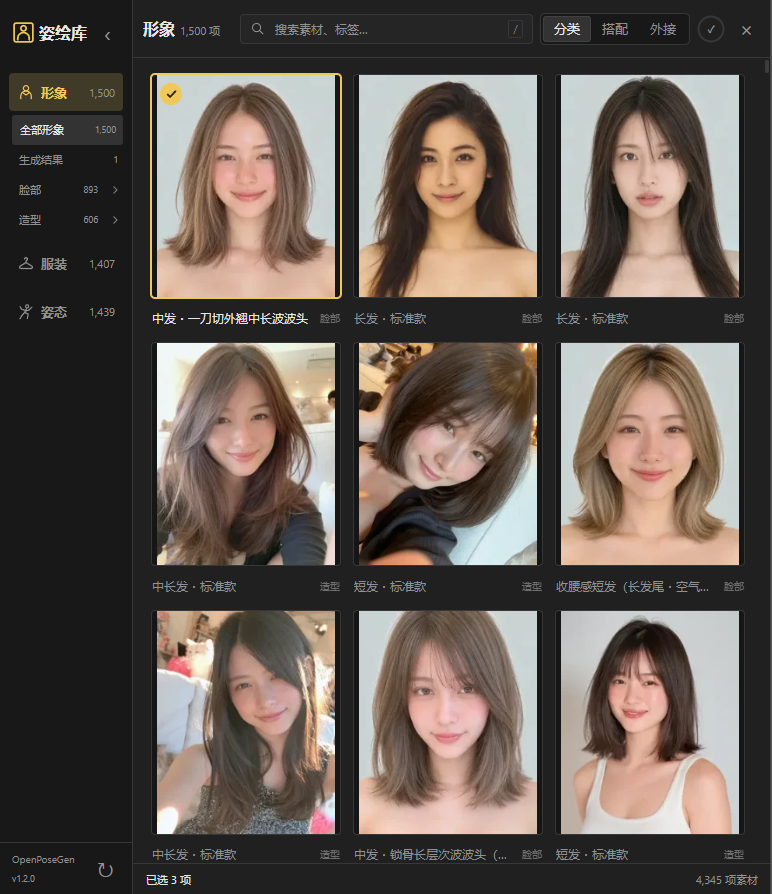
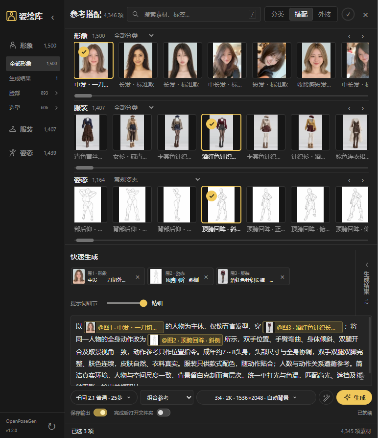

<div align="center">

# OpenPoseGen · 姿绘库


[智能体安装](AGENT_INSTALL.md) · [手动安装](INSTALL.md) · [模型来源](MODELS.md) · [版本清单](release.json) · [反馈问题](https://github.com/BBAIGC/OpenPoseGen/issues)

</div>

**选形象、配服装、定动作，把参考搭配直接送进 ComfyUI。** 姿绘库在画布旁打开，既能拖图到现有工作流，也能用本地模型或自己的云端图像服务生成。它不会替代工作流库，也不会启动时把整套原图读进内存。

## 素材包下载

**原图包的百度云链接将在作者上传后补充于这里及应用关于页。** 发布包不含原图、模型权重或本机密钥。现可使用外接模式导入自己的图片，也可运行仓库的公开来源导入工具准备 RuiC 素材。

参考图库来自 [HRuiCcc/RuiC-PoseAtlas](https://github.com/HRuiCcc/RuiC-PoseAtlas)，共 **4,345 项**：形象1,499、服装1,407、姿态1,439。原作者与图片来源的许可分别适用，详情见 [开源与素材声明](THIRD_PARTY_NOTICES.md)。

## 三种方式使用

| 方式 | 用途 |
| --- | --- |
| 分类 | 按形象、服装、姿态及来源子分类寻找素材；单击选择，双击预览，拖到画布 |
| 搭配 | 三行横向浏览，选择人物、衣装和动作；提示词里的缩略图绑定实际素材，点击可定位 |
| 外接 | 从加载／保存图像节点右键导入，或直接选择、拖入图片；在三行之间拖动分配用途。会话结束后清空外接参考 |

[体验云端无限画布](https://p.ainivox.cn/) 可直接公开访问；[申请API密钥](https://bbapi.ainivox.cn/)为独立入口。

主分类可收起，普通姿态与18+来源系列分开。生成结果保留在独立结果区，重新生成／恢复提示词与参数只填回当次素材、参数和带小图引用的提示词，确认后再提交；粘贴已选图片编号会自动绑定。结果右键可加载图片内工作流、删除前需确认并保留可恢复备份。

## 生成与交互

- 首次打开占画布半幅，拖动右边界可缩窄或展开，记忆上次宽度；入口紧邻工作流库上方。
- 提示词支持参考缩略图、21种场景预设和5档细节。人物、服装和动作各自绑定，避免把姿态线稿当成另一位人物。
- 实时语音在静音后分段识别，识别期间可继续说话；关闭面板释放麦克风、音频上下文和缩略图缓存。
- 默认2K、3:4，实际1536×2048；1K／2K／4K表示长边，13种比例同时显示实际尺寸。
- 模型弹层集中选择引擎、步数、CFG、随机／固定种子及LoRA。每个启用槽位可设置独立细化步数与CFG，会增加一轮实际采样。预留5个空槽，可增至20个，只有启用的LoRA参与生成；强度默认1，切模型保留配置。
- 语言模型页支持本地Ollama千问或云端模型，按5档细节异步优化提示词，保留引用；等待期间用户修改的原文不会被覆盖。语言服务是可选能力，本地未运行或云端返回认证、额度、限流与网络错误时会明确说明。
- 可选文字模型安装：已有Ollama CLI时使用 `-TextModel qwen3.5:9b`；安装器不会替用户启动Ollama。
- 连续提交多个任务，右上进度环和队列显示真实状态。本地按显卡排队，云端使用独立队列、最多16并发，不等待本地推理结束。切换云端会忽略本地LoRA设置。结果按实际比例显示，支持预览、复制、定位文件夹、保存临时结果及加入画布。
- 大图按鼠标位置缩放，按住拖动平移；轻量预览与高清原图分开，生成使用高清参考。

### 生成路线

| 路线 | 配置与参考能力 |
| --- | --- |
| 千问2.1普通 | UC Q6_K、25步；沿成熟多图编辑链，独立有序多图参考 |
| 千问2.1 Turbo | 独立Turbo INT8主模型、固定8步日程；不是普通模型加一个虚拟加速开关 |
| MOSS | Jib V2默认12步；多图会组成参考拼图再重绘，不宣称原生多图语义编辑 |
| BBAPI | 使用用户自己配置的服务与密钥，按实际返回模型列表选择GPT等图像模型；不在仓库提供共享密钥 |

本地LoRA须匹配模型架构；云端路线不展示没有实际作用的本地LoRA和采样控件。没有已验证的千问2.1四步配置，因此未添加四步入口。

## 真实界面

<!-- Publication screenshots are generated from the actual application; no reference library images are bundled here. -->




## 智能体开箱即用 · 复制即装

把下面整段复制给有本地文件、终端和网络权限的智能体。仓库提供精确文件名、下载地址、大小和SHA-256；安装器会复用已有模型，并保留可工作的PyTorch、用户工作流与密钥。

```text
请在我的电脑部署 OpenPoseGen「姿绘库」。
仓库：https://github.com/BBAIGC/OpenPoseGen

先读取 README.md、INSTALL.md、MODELS.md、AGENT_INSTALL.md 和 release.json，再按 AGENT_INSTALL.md 完整执行。自动识别我实际使用的 ComfyUI 实例、核心、Python、模型与用户目录；有多个实例时只澄清目标实例。复用已有共享节点与权重，不安装第二份同名节点，不覆盖我的工作流、配置、密钥、原图和输出，不盲目替换或降级 PyTorch。

默认部署普通千问2.1、Turbo8步、MOSS与实时语音；先计算所缺文件和磁盘空间，只下载 install/models.json 指定且本机没有的文件。完整路线约49.1GB权重，另预留约8GB素材及缓存，模型共用编码器和VAE不重复下载。如果空间或硬件不能运行默认组合，说明实际缺口后只就必要方案问我一次。模型需要登录、验证码或接受许可时由我操作，其他步骤继续自动完成。

安装发布包内共享运行节点、GGUF依赖、Python依赖与工作流，按精确版本准备模型，写入本机 runtime.json。素材包链接若已公布就下载校验导入；尚未公布时先用外接模式，并按公开来源导入工具补齐可用参考。BBAPI可配置但不用我的密钥提交付费测试，不读取或上传其他软件凭据。

完成无付费、无GPU推理的加载检查：入口、三种模式、模型枚举、LoRA列表、实时语音依赖和所有原图路径应可用。需要重新启动ComfyUI才能载入新节点时明确告诉我；不要擅自结束正在运行的生成任务。报告安装位置、版本、已就绪路线和真实缺失项，不把静态检查写成生图质量已验收。
```

完整命令及异常恢复见 [AGENT_INSTALL.md](AGENT_INSTALL.md)。首次完整部署包含大模型下载；已经安装所需路线的用户可只更新代码。

## 安装与运行

下载 [Releases](https://github.com/BBAIGC/OpenPoseGen/releases) 的完整ZIP，解压后先检查安装计划：

```powershell
.\install\install.ps1 -ComfyBase '你的实例目录' -ComfyCore '含folder_paths.py的核心目录' -ComfyPython '当前实例的python.exe' -Plan
```

部署全部默认模型和语音：

```powershell
.\install\install.ps1 -ComfyBase '你的实例目录' -ComfyCore '含folder_paths.py的核心目录' -ComfyPython '当前实例的python.exe' -Models 'qwen,qwen-turbo,moss' -WithSpeech
```

只安装代码和依赖时省略 `-Models`。新增节点须在ComfyUI下次正常启动后载入；现有实例的前端更新通常只需刷新。具体目录识别、已有共享节点冲突及手动安装见 [INSTALL.md](INSTALL.md)。

## 性能与版本

图库按页查询并虚拟化，只读取当前视口附近的缩略图。前端最多4个图片请求、48个等待项，解码上限96张／24MiB，压缩缓存最多96项／8MiB；关闭面板清空图像与录音资源，已排队生成继续。服务端最多2个图像解码线程；大图仅保留当前一张。高清原图用于生成，不以缩略图冒充原始参考。

普通25步及Turbo8步已用三参考、1K竖图完成真实生成与动作复核；其他设备、复杂姿态和4K输出仍需按实际显存验证。图像参考不是硬姿态控制，结果会受模型能力、素材和提示词影响。

版本入口在左下角，关于页提供仓库、更新和开源来源。更新包只覆盖本工具及明确拥有的源码文件，用户数据和素材位于独立目录；发布清单包含SHA-256。

## 联系与支持

问题反馈请使用 [Issues](https://github.com/BBAIGC/OpenPoseGen/issues)，附版本、模型及脱敏错误。以下图片沿用BBAIGC近期公开仓库的联系与自愿支持入口。

<table>
<tr><th>联系作者</th><th>微信支持</th><th>支付宝支持</th></tr>
<tr>
<td align="center"></td>
<td align="center"></td>
<td align="center"></td>
</tr>
</table>

原始软件按 [MIT](LICENSE) 发布。模型、参考图片和各依赖遵循各自许可证，详见 [THIRD_PARTY_NOTICES.md](THIRD_PARTY_NOTICES.md)。
